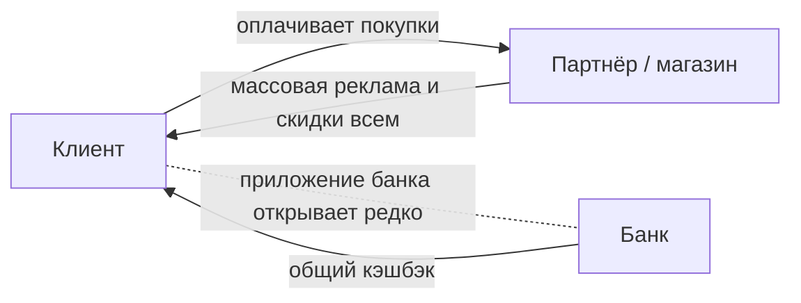
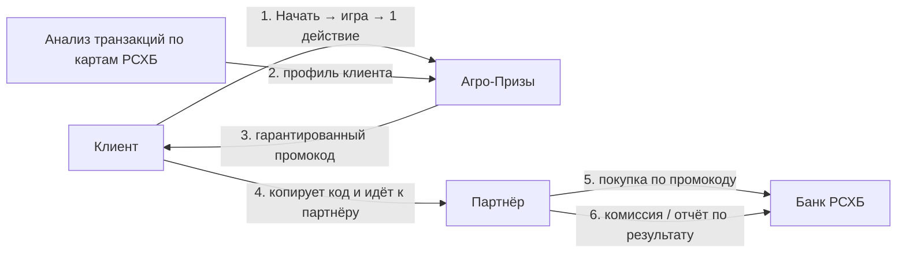
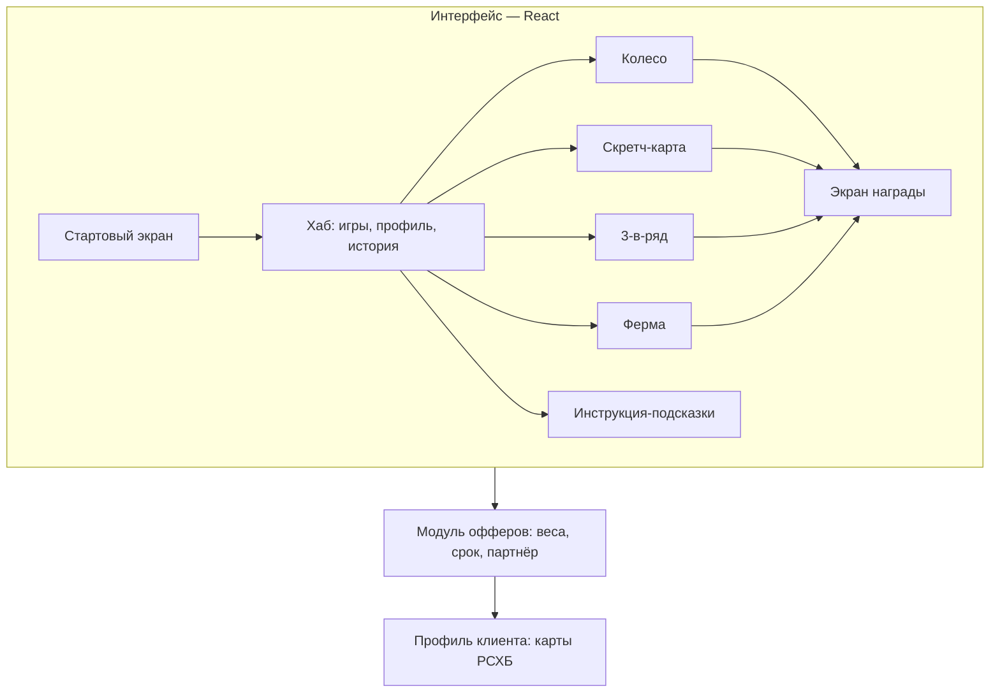
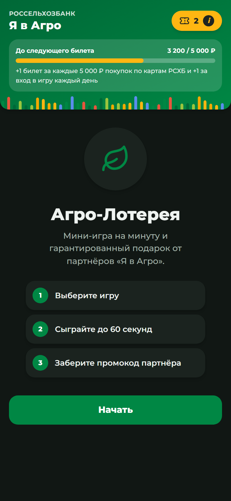
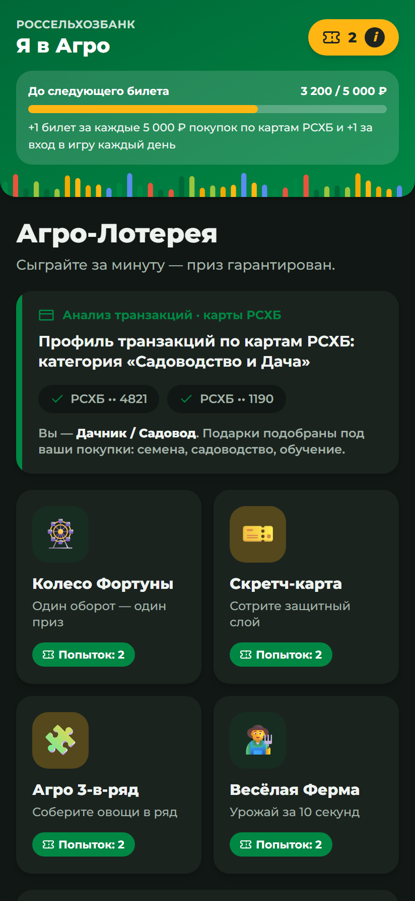
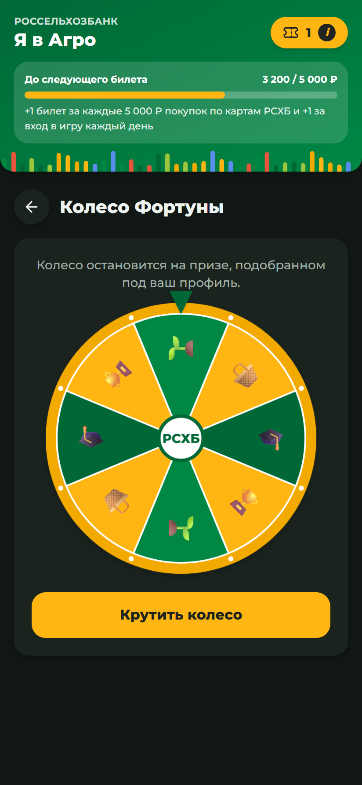
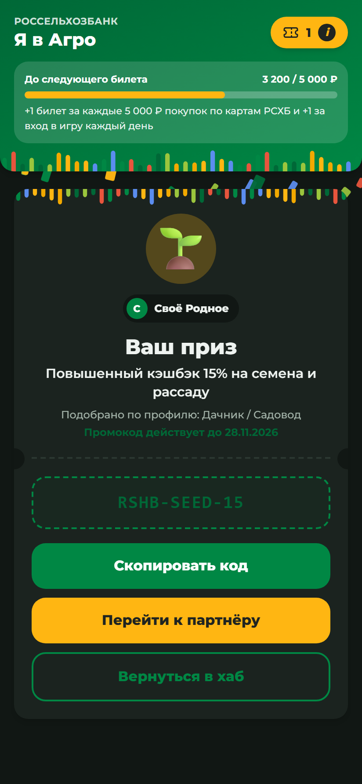
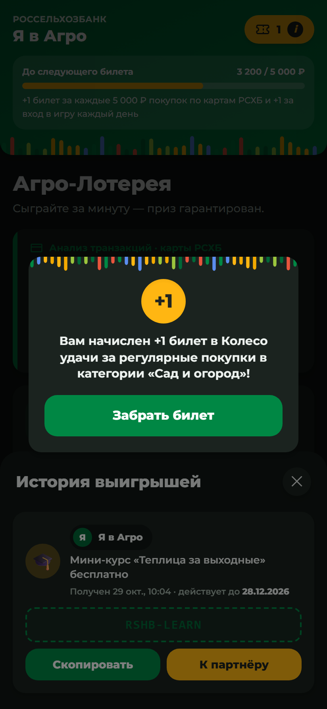

# Агро-Призы РСХБ

**Короткая игра для студентов с гарантированным промокодом партнёра.** Один сеанс — до минуты, одно-два действия, приз получает каждый игрок. Приз подбирается по профилю трат клиента на картах РСХБ.

> Прототип для проекта «Я в Агро» / РСХБ.Цифра. Данные клиента, коды и ссылки партнёров в нём демонстрационные (см. [раздел 8](#8-что-в-прототипе-демо-и-что-нужно-для-продакшена)).

**Содержание:** [1. Проблема](#1-проблема) · [2. Идея](#2-идея-сервиса) · [3. Участники и ценность](#3-участники-и-ценность) · [4. Процессы](#4-процессы-и-схемы) · [5. Продукт и механики](#5-продукт-и-механики) · [6. Как запустить](#6-как-запустить) · [7. Встраивание](#7-встраивание-в-я-в-агро-и-мобильное-приложение) · [8. Демо и продакшен](#8-что-в-прототипе-демо-и-что-нужно-для-продакшена) · [9. Метрики](#9-метрики-успеха) · [10. План и риски](#10-план-работ-роли-и-риски) · [11. Выводы](#11-выводы)

---

## 1. Проблема

**Название:** низкая вовлечённость молодёжи в банковские программы лояльности и размытые, нерелевантные партнёрские предложения.

### 1.1. Кого касается

| Категория                                                                                                     | Суть проблемы                                                                                                                                                                                                               |
| ---------------------------------------------------------------------------------------------------------------------- | --------------------------------------------------------------------------------------------------------------------------------------------------------------------------------------------------------------------------------------- |
| **Студенты** (18–25 лет)                                                                             | Банковские бонусы скучны и не связаны с их реальными покупками. Привычный формат для них — короткие игры и мгновенная награда. |
| **Банк-эмитент (РСХБ)**                                                                           | Клиенты заходят в приложение только по необходимости. Партнёрские предложения массовые, поэтому дают низкую конверсию.            |
| **Партнёры** (маркетплейсы, магазины, образовательные сервисы) | Скидки «всем подряд» стоят дорого и не приводят новых покупателей. Платить хочется за реальный результат.                                      |

### 1.2. Как это выглядит на практике

- **Клиент.** Студент-дачник покупает семена, рассаду и инвентарь, но банк предлагает ему «5% на авиабилеты». Приложение для него — только платёжный инструмент.
- **Банк.** Нужен повод для регулярных заходов в «Я в Агро» и понятный способ показать ценность партнёрской экосистемы.
- **Партнёр.** Он тратит бюджет на общую рекламу, а нужны покупатели из целевой категории, готовые купить именно его товар.

---

## 2. Идея сервиса

**Агро-Призы** — геймифицированный мини-сервис внутри «Я в Агро». Клиент тратит билет на одну из мини-игр, играет не больше минуты и **всегда** получает промокод партнёра. Игры, билеты и анимации можно показать в SDK или iframe внутри мобильного приложения.

Главные принципы:

1. **Быстро.** Сценарий: «Начать» → выбрать игру → одно действие → награда. Это 1–2 действия.
2. **Гарантированно.** Пустых попыток нет: на колесе не бывает «мимо», скретч-карта всегда открывает приз.
3. **Но не одинаково.** Ценность призов разная, выпадение управляется весами: частые призы дешёвые, редкие дорогие.
4. **Персонально.** Модуль мультикарточного анализа определяет профиль клиента (например, «Дачник / Садовод»), и приз подбирается из офферов этой категории. Так партнёр получает целевую аудиторию, а клиент — скидку на то, что ему нужно.
5. **Понятно.** Билеты зарабатываются просто: +1 за вход каждый день и +1 за каждые 5 000 ₽ покупок картами РСХБ.

---

## 3. Участники и ценность

### 3.1. Участники

1. **Клиент** — держатель карты РСХБ, в первую очередь студент.
2. **Банк-эмитент** — АО «Россельхозбанк» (платформа «Я в Агро», РСХБ.Цифра).
3. **Партнёры** — компании, которые выдают промокоды («Своё Родное» и другие).

### 3.2. Ценность для каждого

| Участник                        | Что получает                                                                                                                                                                                                                                                                                                                                                                                                                                                                                                                                                                                               | Чем платит / что даёт                                                                                                                                                                         |
| --------------------------------------- | --------------------------------------------------------------------------------------------------------------------------------------------------------------------------------------------------------------------------------------------------------------------------------------------------------------------------------------------------------------------------------------------------------------------------------------------------------------------------------------------------------------------------------------------------------------------------------------------------------------------- | ------------------------------------------------------------------------------------------------------------------------------------------------------------------------------------------------------------- |
| **Клиент (студент)** | Игра на минуту без риска и условий. Гарантированный приз, выбранный под его реальные покупки. Прозрачные правила: билеты за вход и за траты, история всех призов с датой получения и сроком действия кода.                                                                                                                                                                                                                                       | Внимание на минуту и согласие на анализ транзакций по картам РСХБ.                                                                                     |
| **Банк (РСХБ)**           | Рост регулярных заходов в «Я в Агро» и в мобильное приложение; повод вернуться каждый день. Рост транзакционной активности по картам (билеты привязаны к тратам). Укрепление образа «банка для агро-аудитории» у молодёжи. Новая статья дохода: комиссия партнёров. Данные об интересах клиентов для персонализации других продуктов. | Разработку и поддержку сервиса, интеграцию с аналитикой, часть стоимости призов, если они субсидируются банком. |
| **Партнёр**                | Целевой трафик: промокод получает клиент из релевантной категории. Дозированная скидка вместо общей раздачи. Узнаваемость бренда: логотип показывается в момент радости от выигрыша. Измеримый результат: можно считать переходы и использованные коды.                                                                                                                                            | Скидку, кэшбэк или бонус по промокоду; при модели CPA — комиссию за подтверждённую покупку.                                           |

> **Ключевая выгода партнёра и банка одновременно:** алгоритм выдаёт не случайный код, а оффер в рамках привычной для клиента категории. Партнёр получает конверсию без «перетягивания» клиентов из других категорий, а банк — довольных пользователей.

### 3.3. Ценность промокодов («разные призы»)

Все игры используют один механизм выбора приза с весами. В прототипе для профиля «Садоводство и Дача»:

| Приз                                                   | Партнёр        | Вес выпадения | Срок действия | Ценность                                  |
| ---------------------------------------------------------- | --------------------- | ------------------------- | ------------------------- | ------------------------------------------------- |
| Кэшбэк 15% на семена и рассаду       | Своё Родное | 40%                       | 30 дней               | базовая                                    |
| Скидка 500 ₽ на садовый инвентарь | Своё Родное | 30%                       | 14 дней               | средняя                                    |
| Мини-курс «Теплица за выходные» | Я в Агро        | 20%                       | 60 дней               | средняя+ (образование)          |
| Кэшбэк 25% на весь каталог              | Своё Родное | 10%                       | 7 дней                | высокая, ограниченный срок |

Чем ценнее приз, тем реже он выпадает и тем короче срок действия: так партнёр контролирует бюджет, а клиент получает повод использовать код быстро.

---

## 4. Процессы и схемы

### 4.1. Как было (AS IS)



Клиенту предлагают массовый кэшбэк, партнёр платит за широкую рекламу, а приложение банка остаётся для клиента инструментом оплаты.

### 4.2. Как стало (TO BE)



### 4.3. Устройство сервиса



В прототипе всё работает на стороне браузера. В продакшене модуль офферов, выдача кодов и профиль клиента переезжают на бэкенд (см. раздел 8).

---

## 5. Продукт и механики

### 5.1. Путь клиента (1–2 действия)

1. **Старт.** Приветствие и кнопка «Начать». При первом входе показывается интерактивная инструкция.
2. **Хаб.** Блок «Карты РСХБ» с профилем трат, четыре игры, шкала билетов в шапке и кнопка «История выигрышей». С вероятностью 1/3 появляется окно «+1 билет за регулярные покупки в категории „Сад и огород“».
3. **Игра (до минуты).** Одно действие: вращение колеса, стирание карточки, ход в 3-в-ряд или несколько кликов на ферме.
4. **Награда.** Карточка приза, логотип партнёра, промокод, срок действия. Кнопки: **Скопировать код** (меняется на «Скопировано!»), **Перейти к партнёру** (новая вкладка), **Вернуться в хаб**.
5. **История.** Все призы списком: новые сверху, у каждого дата получения, срок действия, копирование кода и переход к партнёру.

### 5.2. Игры

| Игра                    | Действие клиента                                                                                                              | Время |
| --------------------------- | -------------------------------------------------------------------------------------------------------------------------------------------- | ---------- |
| Колесо Фортуны | Нажать «Крутить колесо». Колесо останавливается на заранее выбранном призе. | ~10 с     |
| Скретч-карта     | Стереть защитный слой пальцем (прогресс до 55%).                                                         | ~15–30 с |
| Агро 3-в-ряд        | Поменять две соседние плитки так, чтобы получился ряд из трёх.                            | ~20–40 с |
| Весёлая Ферма   | Поливать грядку кликами, урожай созревает за 10 секунд.                                          | 10 с      |

### 5.3. Билеты и прогрессия

- Одна игра = один билет.
- **+1 билет** — каждый день при входе в «Агро-Призы».
- **+1 билет** — за каждые 5 000 ₽ покупок картами РСХБ. Шкала прогресса отображена в шапке.
- Значок билета с «i» всегда открывает инструкцию: она подсвечивает шапку, шкалу, блок карт, игры и историю.

### 5.4. Экраны для демонстрации

Скриншоты ключевых состояний прототипа (размещены в `docs/screens/`):

| Экран                                                                                   | Файл                        | Описание                                                                                                  |
| -------------------------------------------------------------------------------------------- | ------------------------------- | ----------------------------------------------------------------------------------------------------------------- |
| Запуск (старт + инструкция)                                             | `docs/screens/01-start.png`   | Стартовый экран приветствия и интерактивная инструкция           |
| Хаб                                                                                       | `docs/screens/02-hub.png`     | Профиль карт РСХБ, баланс попыток и витрина доступных игр         |
| Игровой момент                                                                  | `docs/screens/03-game.png`    | Процесс мини-игры (Колесо Фортуны)                                                    |
| Награда: промокод, копирование, переход к партнёру | `docs/screens/04-reward.png`  | Карточка выигранного приза, промокод, копирование и переход    |
| История выигрышей                                                            | `docs/screens/05-history.png` | Список всех полученных промокодов со статусом срока действия |

<p align="center">
  
  
  
  
  
</p>

### 5.5. Дизайн

Фирменные цвета РСХБ (зелёный `#008744` / `#006837`, золотой `#FFB612` / `#F2A900`, фон `#F4F6F8`, текст `#1F2421`), скругления 16 px, мобильная вёрстка до 480 px, паттерн «разнотравье» как в айдентике банка, поддержка тёмной темы.

---

## 6. Как запустить

Приложение — это **один файл `index.html`**: React, Tailwind и шрифт подключаются с CDN, сборка не нужна. Нужен только интернет.

### Вариант 1. Двойной клик

1. Скачайте или склонируйте репозиторий.
2. Откройте `index.html` в браузере (Chrome, Safari, Edge, Firefox).

### Вариант 2. Локальный сервер

```bash
git clone https://github.com/Wolf-prog/agro-prizes.git
cd agro-prizes
python3 -m http.server 8080
# откройте http://localhost:8080
```

### Вариант 3. GitHub Pages (публичная ссылка для демонстрации)

1. Загрузите `index.html` в корень репозитория.
2. **Settings → Pages → Build and deployment → Deploy from a branch**, ветка `main`, папка `/ (root)`.
3. Через минуту страница откроется по адресу `https://wolf-prog.github.io/agro-prizes/`.

### Как посмотреть разные сценарии

| Что проверить                           | Как                                                                                                                                                                     |
| --------------------------------------------------- | -------------------------------------------------------------------------------------------------------------------------------------------------------------------------- |
| Инструкция при первом входе | Откройте в приватном окне или очистите данные сайта. В браузере запоминается ключ `agro_tour_seen`. |
| Повторный показ инструкции  | Нажмите на значок билета с «i» в шапке.                                                                                                      |
| Окно «+1 билет»                          | Появляется с вероятностью 1/3 при входе в хаб — перезайдите несколько раз.                                      |
| Закончились билеты                 | Сыграйте несколько раз: стартовых билетов два, игры блокируются на нуле.                                       |

---

## 7. Встраивание в «Я в Агро» и мобильное приложение

Страница адаптивна и рассчитана на узкий контейнер (до 480 px). Для встраивания через `iframe`:

```html
<iframe
  src="https://wolf-prog.github.io/agro-prizes/index.html"
  title="Агро-Призы РСХБ"
  width="100%" height="760"
  style="border:0"
  allow="clipboard-write">
</iframe>
```

- `allow="clipboard-write"` нужен, чтобы кнопка «Скопировать код» работала внутри `iframe`. Если разрешения нет, срабатывает запасной способ копирования.
- В мобильном приложении страницу открывают в WebView с включённым JavaScript.
- Ссылки на партнёров открываются в новой вкладке или во внешнем браузере. Для WebView это нужно согласовать с командой приложения.

---

## 8. Что в прототипе демо, а что нужно для продакшена

В прототипе всё хранится в браузере, а ключевые данные заданы вручную. Для запуска в реальной среде их нужно заменить.

| Элемент                                             | В прототипе                                                             | В продакшене                                                                                                             |
| ---------------------------------------------------------- | --------------------------------------------------------------------------------- | ----------------------------------------------------------------------------------------------------------------------------------- |
| Профиль клиента и карты РСХБ       | Зашиты в коде («Дачник / Садовод»)                      | Результат модуля мультикарточного анализа через API, с согласия клиента  |
| Траты клиента для шкалы билетов | 3 200 ₽ из 5 000 ₽ — демо                                                | Данные по реальным транзакциям карт РСХБ                                                         |
| Начисление билетов                        | Стартовые 2 билета, «+1 в день» только описано | Серверный учёт: дневное начисление и начисление за траты                            |
| Промокоды                                         | Статичные заглушки                                               | Уникальные одноразовые коды: выгрузка пула от партнёра или API генерации |
| Выбор приза                                      | Случайно по весам, в браузере                             | На сервере, с защитой от подмены и накрутки                                                      |
| Ссылки партнёров                            | Заглушки                                                                  | Боевые ссылки с UTM-метками (`utm_source=rshb&utm_campaign=agro_prizes`)                                      |
| Логотипы партнёров                        | Буква на цветном фоне                                           | Логотипы по брендбуку партнёра, внедряются в блок «Партнёры»                    |
| История призов                                | Хранится до перезагрузки страницы                   | Хранится на сервере, привязана к клиенту                                                          |
| Аналитика                                         | Нет                                                                            | События воронки (раздел 9)                                                                                      |

### Как подключить бренд партнёра

1. Получите от партнёра логотип (SVG/PNG), допустимые цвета, правила использования бренда и условия оффера.
2. Добавьте оффер: название партнёра, описание приза, код, ссылку, вес выпадения, срок действия.
3. Добавьте карточку бренда: логотип в формате data-URI и фирменный цвет.
4. Согласуйте с партнёром тексты и тестовую выдачу кодов, затем включите оффер в боевую ротацию.

Бренд партнёра виден на экране награды, в истории выигрышей и на скретч-карте под защитным слоем.

---

## 9. Метрики успеха

Целевые значения нужно подтвердить на пилоте. Это гипотезы, а не обещания.

| Метрика                                                                              | Что показывает                                                                                      |
| ------------------------------------------------------------------------------------------- | ---------------------------------------------------------------------------------------------------------------- |
| Доля запусков, дошедших до награды                             | Простота сценария (цель — около 100% при гарантированном призе) |
| Время сессии                                                                     | Выполнение требования «не больше минуты»                                     |
| Доля скопированных кодов                                              | Интерес к призу                                                                                     |
| CTR «Перейти к партнёру»                                                  | Интерес к партнёру                                                                               |
| Доля использованных кодов (redemption)                               | Реальная ценность для партнёра                                                        |
| Возврат на 7-й и 30-й день, число игр на пользователя | Привычка и вовлечённость                                                                   |
| Стоимость привлечённой покупки (CPA) для партнёра    | Окупаемость для партнёра                                                                   |
| Рост трат по картам РСХБ у участников                        | Ценность для банка                                                                               |

События для сбора: вход в хаб, просмотр инструкции, старт игры, получение приза, копирование кода, переход к партнёру, использование кода.

---

## 10. План работ, роли и риски

### 10.1. Этапы

| Этап                                     | Содержание                                                                                                                                                                                            | Результат                                   |
| -------------------------------------------- | --------------------------------------------------------------------------------------------------------------------------------------------------------------------------------------------------------------- | ---------------------------------------------------- |
| **0. Прототип** (готово) | Экраны, четыре игры, награда, история, инструкция                                                                                                                       | Интерактивный демо-прототип |
| **1. Пилот**                      | Бэкенд для выдачи кодов и выбора приза, интеграция профиля и трат, аналитика, 1–2 партнёра, ограниченная аудитория | Первые реальные метрики         |
| **2. Масштабирование**  | Новые партнёры и профили («Фермер», «Студент», «Городской»), SDK для приложения банка, A/B-тесты весов и сроков             | Рост охвата и конверсии          |
| **3. Развитие**                | Командные и сезонные механики, рейтинги, интеграция с кредитными и вкладными продуктами                                              | Новые источники дохода           |

### 10.2. Роли

| Роль                                 | Ответственность                                                                       |
| ---------------------------------------- | ---------------------------------------------------------------------------------------------------- |
| Продакт-менеджер          | Ценностное предложение, механики, метрики, приоритеты  |
| Проджект-менеджер        | Сроки, зависимости, коммуникации с банком и партнёрами |
| Дизайнер                         | Соблюдение брендбука, новые игры и сезонные темы            |
| Разработка                     | Фронтенд, бэкенд, интеграции, антифрод                               |
| Аналитик                         | Профилирование, события, отчёты для партнёров                 |
| Юристы и безопасность | Согласие клиента, персональные данные, правила акции    |
| Партнёр-менеджер          | Подключение партнёров, условия, коды, отчётность            |

### 10.3. Риски и меры

| Риск                                                                      | Мера                                                                                                                                                                                                                                                                                                                                                                                                                                                                                                                                                                                                                                                                                                                                                                                                                                                                                                                                                                                                                                                                                                                                                                                                                                                                          |
| ----------------------------------------------------------------------------- | --------------------------------------------------------------------------------------------------------------------------------------------------------------------------------------------------------------------------------------------------------------------------------------------------------------------------------------------------------------------------------------------------------------------------------------------------------------------------------------------------------------------------------------------------------------------------------------------------------------------------------------------------------------------------------------------------------------------------------------------------------------------------------------------------------------------------------------------------------------------------------------------------------------------------------------------------------------------------------------------------------------------------------------------------------------------------------------------------------------------------------------------------------------------------------------------------------------------------------------------------------------------------------- |
| Накрутка и боты                                                  | Серверная выдача призов, лимиты билетов, проверка сессий                                                                                                                                                                                                                                                                                                                                                                                                                                                                                                                                                                                                                                                                                                                                                                                                                                                                                                                                                                                                                                                                                                                                                                          |
| Приз «на подделку» (подмена на клиенте)       | Выбор приза и код только на сервере                                                                                                                                                                                                                                                                                                                                                                                                                                                                                                                                                                                                                                                                                                                                                                                                                                                                                                                                                                                                                                                                                                                                                                                                                  |
| Низкое использование кодов                            | Короткие сроки у ценных призов, напоминания, проверка релевантности офферов                                                                                                                                                                                                                                                                                                                                                                                                                                                                                                                                                                                                                                                                                                                                                                                                                                                                                                                                                                                                                                                                                                                                      |
| Недовольство партнёра ценой                          | Регулируемые веса, лимиты кодов, модель CPA                                                                                                                                                                                                                                                                                                                                                                                                                                                                                                                                                                                                                                                                                                                                                                                                                                                                                                                                                                                                                                                                                                                                                                                                      |
| Работа с персональными данными                     | Согласие на анализ транзакций, минимизация данных, согласование с ИБ и юристами                                                                                                                                                                                                                                                                                                                                                                                                                                                                                                                                                                                                                                                                                                                                                                                                                                                                                                                                                                                                                                                                                                                                |
| Юридическая квалификация механики (отказ от термина «лотерея») | Для исключения регуляторных рисков по Федеральному закону № 138-ФЗ «О лотереях» сервис получил официальное название «Агро-Призы», а термин «лотерея» полностью исключён из интерфейса и коммуникаций. По законодательству РФ механика является стимулирующим мероприятием (рекламной акцией по ст. 9 ФЗ № 38-ФЗ «О рекламе» и публичным обещанием награды по ст. 1055 ГК РФ): плата за участие отсутствует (билеты начисляются бесплатно за транзакции и ежедневный вход), а приз гарантирован каждому участнику (100% выигрыш, отсутствие риска). Перед запуском пилота разрабатываются и согласуются с юристами правила стимулирующей акции и пользовательское соглашение. |
| Платформенные ограничения WebView                     | Тест в iOS и Android до пилота                                                                                                                                                                                                                                                                                                                                                                                                                                                                                                                                                                                                                                                                                                                                                                                                                                                                                                                                                                                                                                                                                                                                                                                                                                      |

---

## 11. Выводы

**Почему это понятно участникам.** Клиент играет минуту и получает скидку, партнёр видит результат в покупках, банк получает возврат клиентов и данные для персонализации. Нет скрытых условий, а приз гарантирован.

**Почему это ценно.** Сервис превращает рутинный сценарий «получить промокод» в короткий момент радости. Партнёры платят за целевой, а не массовый контакт. Банк объединяет геймификацию, аналитику карт и экосистему партнёров в одном простом продукте.

**Что дальше.** Подключить реальные данные клиента и партнёров, провести пилот на ограниченной аудитории и скорректировать веса призов, сроки и список партнёров по результатам первых метрик.

---

*Прототип. Все названия партнёров, коды и условия акций — демонстрационные.*
